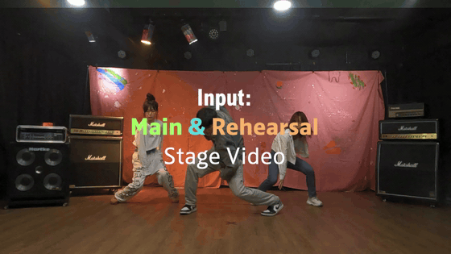

# [IJCV 2026] RehearsalNeRF

Official implementation of **"RehearsalNeRF: Decoupling Intrinsic Neural Fields of Dynamic Illuminations for Scene Editing"** (IJCV 2026)

[[Paper]](https://link.springer.com/article/10.1007/s11263-026-02816-0) [[Project Page]](https://wcy199705.github.io/RehearsalNeRF/)



## TODO

- [x] Training and rendering code
- [x] Example dataset and pretrained checkpoint (scene `01`)
- [ ] Data preprocessing code
- [ ] Other datasets
- [ ] Other pretrained checkpoints

## Installation

### Requirements

- Linux with an NVIDIA GPU and the CUDA toolkit (`nvcc`)
- 24GB of GPU memory for the default training settings (smaller GPUs: see [Training](#training))
- Tested with Python 3.10, PyTorch 2.5.1, and CUDA 12.1

### Setup

```bash
conda create -n rehearsalnerf python=3.10 -y
conda activate rehearsalnerf

# The CUDA version of PyTorch must match your system nvcc (`nvcc --version`), e.g. CUDA 12.1
pip install torch==2.5.1 torchvision==0.20.1 --index-url https://download.pytorch.org/whl/cu121

# tiny-cuda-nn is not on PyPI; build it from source
pip install "setuptools<70" wheel ninja
pip install --no-build-isolation "git+https://github.com/NVlabs/tiny-cuda-nn/#subdirectory=bindings/torch"

pip install numpy tqdm matplotlib pandas imageio av opencv-python-headless pillow lpips \
            scikit-learn scikit-image torchmetrics tensorboard
```

> If the tiny-cuda-nn build fails, first check that the CUDA version of PyTorch matches `nvcc --version`. See [NVlabs/tiny-cuda-nn](https://github.com/NVlabs/tiny-cuda-nn) for other build issues.

## Downloads

| Item | Size | Link | Location |
|------|------|------|----------|
| Example dataset (scene `01`) | 42GB | [Google Drive](https://drive.google.com/drive/folders/1vGwBzt4OrZoxUvU7KBGJy9rqmwk0Ksl2) | `dataset/KPOP/01/` |
| Pretrained checkpoint (`logs` folder) | 709MB | [Google Drive](https://drive.google.com/drive/folders/19sfhV3zUa-tmWYszhQ54m_p-cnM12a2y) | `code/plenoxels/logs/` |

All paths in the configs are relative to `code/plenoxels/`, so after downloading, the project should look like this:

```
RehearsalNeRF/
├── dataset/                          # Google Drive "dataset" folder
│   └── KPOP/01/
└── code/plenoxels/
    ├── dataset -> ../../dataset      # symlink (see below)
    └── logs/                         # Google Drive "logs" folder
        └── KPOP/01/
            └── 120000model.pth
```

Create the dataset symlink from the project root:

```bash
ln -s ../../dataset code/plenoxels/dataset
```

To render with the pretrained checkpoint:

```bash
cd code/plenoxels
PYTHONPATH='.' python ./plenoxels/main.py \
  --config-path ./plenoxels/configs/scenes/01.py \
  --log-dir logs/KPOP/01 \
  --model_name 120000model.pth \
  --render-only
```

Rendered videos are saved to `code/plenoxels/logs/01/RehearsalNeRF/` (the `logdir` of the scene config).

## Usage

All commands are run from `code/plenoxels/` with `PYTHONPATH='.'`.

### Training

```bash
# Using the helper script (from project root)
bash code/scripts/train.sh plenoxels/configs/scenes/01.py 0

# Or directly
cd code/plenoxels
PYTHONPATH='.' python ./plenoxels/main.py \
  --config-path ./plenoxels/configs/scenes/01.py
```

With the default `batch_size=3072`, training uses about 19GB of GPU memory on an RTX 3090 (24GB).

Config parameters can be overridden from the command line. On GPUs with less memory, lower the batch size (`batch_size=2048` uses about 16GB):
```bash
PYTHONPATH='.' python ./plenoxels/main.py \
  --config-path ./plenoxels/configs/scenes/01.py batch_size=2048
```

### Rendering

Requires a trained checkpoint (`--log-dir` and `--model_name`). Training saves checkpoints to `code/plenoxels/logs/<scene_id>/RehearsalNeRF/<step>model.pth`:

```bash
# Using the helper script
bash code/scripts/render.sh plenoxels/configs/scenes/01.py logs/01/RehearsalNeRF 120000model.pth --render-only 0

# Or directly
cd code/plenoxels
PYTHONPATH='.' python ./plenoxels/main.py \
  --config-path ./plenoxels/configs/scenes/01.py \
  --log-dir logs/01/RehearsalNeRF \
  --model_name 120000model.pth \
  --render-only
```

### Rendering Modes

| Flag | Description |
|------|-------------|
| `--render-only` | Full scene rendering to video |
| `--validate-only` | Compute validation metrics (PSNR, SSIM, MS-SSIM) |
| `--hue_test` | Render with multiple hue variations |
| `--intensity_left/right/center` | Apply an intensity map (Intensity Change in [Project Page](https://wcy199705.github.io/RehearsalNeRF/); requires `--intensity_map <path.pth>`, see below) |

The intensity modes need an extra `--intensity_map` argument, which `render.sh` does not pass, so run them directly:

```bash
cd code/plenoxels
PYTHONPATH='.' python ./plenoxels/main.py \
  --config-path ./plenoxels/configs/scenes/01.py \
  --log-dir logs/KPOP/01 \
  --model_name 120000model.pth \
  --intensity_left \
  --intensity_map ../left_intensity.pth
```

Example intensity maps for scene `01` are provided in `code/` (`left_intensity.pth`, `right_intensity.pth`, `center_intensity.pth`). An intensity map is a float tensor of shape `[num_frames, H, W]` (`75 x 760 x 1352` for scene `01`) saved with `torch.save`; it scales the illumination intensity per pixel. The flag name (`left`, `right`, `center`) only sets the output file name.

## Dataset Structure

> **Note:** The dataset preprocessing code will be updated. Other datasets will also be released later.

Each scene directory should follow this layout:

```
dataset/KPOP/<scene_id>/
├── colmap_reh/ws/poses_bounds.npy   # Camera poses, near/far bounds, intrinsics (H, W, focal)
├── reh/
│   ├── videos/*.mp4                 # Rehearsal videos (one per camera)
│   └── v_mask/*.mp4                 # Rehearsal masks
├── liv/
│   ├── videos/*.mp4                 # Live performance videos (one per camera)
│   └── v_mask/*.mp4                 # Live masks
├── warped/*.mp4                     # Flow-warped RGB
├── warped_conf.pth                  # Warping confidence
├── sque_flow.pth                    # Sequential optical flow
├── sque_conf.pth                    # Sequential flow confidence
└── temporal_hues.pt                 # Per-frame hues (created on the first training run; required for rendering)
```

The first camera (sorted by filename) is held out for testing.

## Configuration

All configs inherit from `configs/base_config.py`. Scene configs only override scene-specific values:

```python
# configs/scenes/01.py
from configs.base_config import base_config

config = {
    **base_config,
    'logdir': './logs/01',
    'data_dirs': ['./dataset/KPOP/01'],
}
```

### Adding a New Scene

1. Prepare your dataset in the required format under `dataset/KPOP/<scene_id>/`.
2. Create a config file:

```python
# configs/scenes/<scene_id>.py
from configs.base_config import base_config

config = {
    **base_config,
    'logdir': './logs/<scene_id>',
    'data_dirs': ['./dataset/KPOP/<scene_id>'],
}
```

3. Train: `bash code/scripts/train.sh plenoxels/configs/scenes/<scene_id>.py`

## Citation

```bibtex
@article{won2026rehearsalnerf,
  title={RehearsalNeRF: Decoupling Intrinsic Neural Fields of Dynamic Illuminations for Scene Editing},
  author={Won, Changyeon and Jung, Hyunjun and Cho, Jungu and Park, Seonmi and Lee, Chi-Hoon and Jeon, Hae-Gon},
  journal={International Journal of Computer Vision},
  volume={134},
  number={6},
  pages={257},
  year={2026},
  publisher={Springer}
}
```

## Acknowledgements

Our code is built upon [K-Planes](https://github.com/sarafridov/K-Planes). We thank the authors for releasing their code.

## License

This project follows the license of K-Planes and is released under the [BSD 3-Clause License](code/LICENSE_KPlane).
